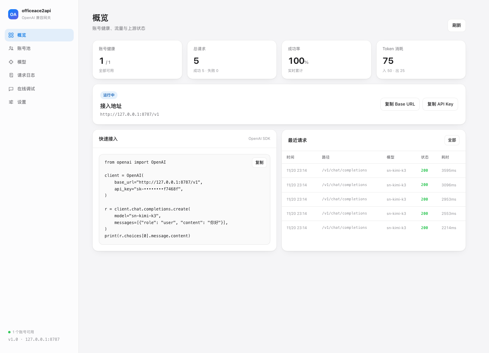

# officeace2api

把 **OfficeAce 桌面客户端**（上游 `xiaohuanxiong.com`）的登录态变成 **OpenAI / Anthropic 兼容 API** 的多账号网关，附 Web 管理面板。

单二进制、零外部依赖、零数据库：账号、配置、日志都在本地文件与内存里。




---

## 一、协议结论（实测，非猜测）

| 项 | 值 | 来源 |
|---|---|---|
| 上游 Base | `https://xiaohuanxiong.com/api/web/llm/v2` | 客户端 `agent/config/config.yaml` |
| 对话 | `POST {base}/chat/completions` | 实测 200，OpenAI 兼容 |
| 图片 | `POST {base}/images/gen` | 实测 200，返回 `data[].b64_json` |
| 鉴权 | `Authorization: Bearer <access_token>` | JWT，`iss=xiaohuanxiong.com/iam` |
| 附加头 | 仅 `Content-Type: application/json` | 客户端源码 `packages/api/dist/index.js` 同样只用这两个头 |
| 凭证落盘 | `~/Library/Application Support/office-raccoon/agent/config/auth.json` | `{access_token, office_identity}` |
| 凭证引用 | `model-profiles.json` 里 `apiKey: "box-agent-auth-json"` 指向上面的文件 | 客户端用文件回填，不写死在配置里 |
| 无效 token | `HTTP 401 {"code":200003,"message":"authorization_verify_error"}` | 实测 |
| 默认模型 | `sn-kimi-k3`、`sn-deepseek-v4-1-flash-1017`、`sn-image` | 客户端配置与实测 |
| JWT 有效期 | 约 30 天（实测签发自 2026-10-26，到期 2026-11-25） | payload `exp` |

> 结论：上游没有私有签名、没有设备指纹头、没有 WAF 校验，就是一个 OpenAI 兼容端点。网关要做的是**选号、冷却、记账**，不是协议翻译。

## 二、快速开始

```bash
go build -o officeace2api .
./officeace2api -data data
```

首次启动会在终端打印：

```
面板      http://127.0.0.1:8787/
面板密钥  pk-xxxxxxxx
API Key   sk-xxxxxxxx
账号数    0
```

打开面板 → 输入面板密钥 → **账号池 → 导入本机凭证**（或等 30 秒自动同步，前提是 OfficeAce 客户端已登录）。

```bash
# 验证
curl -s http://127.0.0.1:8787/v1/chat/completions \
  -H "Authorization: Bearer <API Key>" \
  -H "Content-Type: application/json" \
  -d '{"model":"sn-kimi-k3","messages":[{"role":"user","content":"你好"}]}'
```

### Docker

```bash
docker compose up -d --build
docker logs officeace2api | head -20   # 取面板密钥
```

容器里读不到宿主机的客户端凭证：要么在面板手动粘贴 token，要么把
`~/Library/Application Support/office-raccoon/agent/config/auth.json`
挂进容器并改 `local_auth_paths`。

## 三、接口

| 方法 | 路径 | 说明 |
|---|---|---|
| POST | `/v1/chat/completions` | OpenAI 对话，`stream` 流式/非流式 |
| GET | `/v1/models` | 模型列表 |
| POST | `/v1/images/generations` | 文生图，OpenAI images 形态 |
| POST | `/v1/messages` | Anthropic Messages（Claude Code 可直连） |
| POST | `/v1/messages/count_tokens` | 粗略 token 估算 |
| GET | `/healthz` | 探活 + 池快照 |

网关鉴权三种写法都认：`Authorization: Bearer <key>`、`x-api-key`、`?key=`。

### Python SDK

```python
from openai import OpenAI

client = OpenAI(base_url="http://127.0.0.1:8787/v1", api_key="sk-...")
r = client.chat.completions.create(
    model="sn-kimi-k3",
    messages=[{"role": "user", "content": "你好"}],
)
print(r.choices[0].message.content)
```

### Claude Code

```bash
export ANTHROPIC_BASE_URL=http://127.0.0.1:8787
export ANTHROPIC_AUTH_TOKEN=sk-...
export ANTHROPIC_MODEL=sn-kimi-k3
claude
```

`tools` / `tool_use` / `input_json_delta` 都做了双向转换，工具调用链可用（已验证 `stop_reason: tool_use` 与流式分片）。

## 四、面板

- **概览**：账号健康度、请求量、成功率、token 消耗、接入地址、最近请求
- **账号池**：状态（正常/冷却/过期/停用）、有效期倒计时、请求与成功率、体检、备注、停用、删除；下方列出本机客户端发现的凭证（只读）
- **模型**：对外模型名 ↔ 上游模型名映射，可增删改，设默认
- **请求日志**：500 条环形缓冲，含 IP/UA/耗时/TTFB/token/错误原因
- **在线调试**：直接打网关验证账号可用性
- **设置**：上游地址、重试、冷却、超时、粘性 TTL、本机同步路径、双密钥

## 五、账号池行为

| 机制 | 取值 | 说明 |
|---|---|---|
| 选号 | 加权随机 | 权重 ∝ 1/(1+在途) × 成功率 × 距上次使用时长，避免热点 |
| 会话粘性 | 默认 1800s | 取 `metadata.conversation_id` / `X-Conversation-Id` / `conversation_id` / `user` |
| 401/403 | 冷却 30 分钟 | 视为凭证失效，立即换号重试 |
| 429 | 冷却 2 分钟 | 换号重试 |
| 402 | 冷却 12 小时 | 额度不足 |
| 5xx | 冷却 30 秒 | 换号重试 |
| 重试 | 默认 2 次 | 只在响应头未下发前换号 |

## 六、凭证生命周期

```
OfficeAce 登录
   └─> ~/Library/Application Support/office-raccoon/agent/config/auth.json
          └─> officeace2api 每 30s 扫描（config.local_auth_paths，支持通配符）
                 └─> 按 sub 去重入池；token 轮换时自动覆盖，统计与开关保留
```

- token 过期后**重开 OfficeAce 客户端**触发刷新，网关会在 30 秒内自动跟进。
- 手动导入的 token 不会自动刷新；建议优先用本机同步。
- `data/accounts.json` 是**明文凭证**，权限 0600。不要提交到仓库、不要放共享目录。

## 七、目录

```
main.go                      启动、装配、优雅退出
internal/config/             配置加载/热更新/落盘（data/config.json）
internal/account/            JWT 解析、账号池、选号、冷却、粘性、持久化
internal/upstream/           上游 HTTP 客户端、错误分类
internal/server/             路由、OpenAI 前门、Anthropic 前门、面板 API
internal/web/index.html      内嵌单页面板（明暗主题）
data/                        config.json + accounts.json（运行时生成）
scripts/probe.sh             绕过网关直打上游，用于验证协议
```

## 八、排障

| 现象 | 原因 | 处理 |
|---|---|---|
| `503 账号池没有可用账号` | 全部过期/冷却/停用 | 面板看状态；重开客户端刷新 token |
| `401 invalid api key` | 调用方 key 不对 | 面板「设置 → 网关密钥」核对 |
| `upstream 401 authorization_verify_error` | token 失效 | 客户端重新登录，等同步 |
| 图片请求 25s+ | 上游生成本身慢 | 调大 `request_timeout_sec` |
| 流式没有 usage | 上游未返回 | 网关已注入 `stream_options.include_usage`，部分模型仍可能省略 |

## 九、发布

仓库：`rsfree/officeace`。**push 到 main 即自动发版**（patch 自增），workflow 在 `.github/workflows/release.yml`。

| 环节 | 行为 |
|---|---|
| 版本号 | 取最新 `v*.*.*` tag 的 patch +1；零 tag 时从 `v0.0.1` 起 |
| 构建 | `linux/amd64`、`linux/arm64`、`darwin/amd64`、`darwin/arm64`、`windows/amd64`，`-X main.version` 注入版本 |
| 冒烟 | 用 linux 产物起一次服务，断言 `/healthz` 的 `version` 与本次 tag 一致，不过不发版 |
| 产物 | Release 附件 5 个二进制 + `SHA256SUMS`，同时移动 `latest` 指针 |
| 跳过 | commit message 含 `[skip release]`（该字面量匹配整条 message，别在“描述它”的提交里写） |
| 手动补跑 | Actions → Release → Run workflow |

本地构建想带版本号：

```bash
go build -ldflags "-X main.version=$(git describe --tags --always)" -o officeace2api .
```

## 十、许可与使用边界

代码以 **MIT** 许可发布，全文见 [LICENSE](LICENSE)：可自由使用、修改、分发、商用，保留版权与许可声明即可。

但许可只覆盖**代码**，不覆盖上游服务本身：

- **请只管理你本人的账号。** 批量注册、账号交易、对外转售额度都不在作者的授权意图内，由此产生的合规责任由行为人自负。
- **风险自担。** 上游接口与风控策略随时可能变更；使用非官方客户端导致的账号限制或封禁，作者不承担任何责任。
- **仓库不含凭证。** `data/` 已在 `.gitignore` 中排除，Release 产物里也没有任何账号信息。
- **不做伪装。** 不改 UA、不加假指纹、不绕验证码，请求特征与官方客户端保持一致。
- **接口变更时**：先跑 `scripts/probe.sh` 确认端点是否存活，再改 `config.json` 的 `upstream_base`。
- 与 OfficeAce / 小浣熊官方无关，未获其授权或背书。
